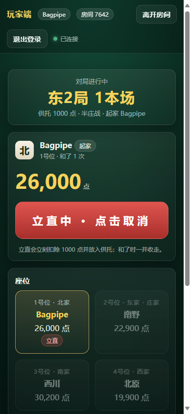

# 立直麻将 · 场风盘（Riichi Scoreboard）

五台移动设备（1 台场风盘 + 4 台玩家端）的**雀庄公式战式**对局记录系统。
零依赖，只用 Node.js 内置模块，**不需要 `npm install`**，运行时也**不需要联网**。

- 场风盘（1 台平板/笔记本）：建房、掷骰定起家、记点数、记立直、结算、存档
- 玩家端（4 台手机）：登录账号、输房间号入座、一键立直、看自己的点数和历史
- 管理员端：在服务器电脑上查看全站对局记录、玩家统计、导出 CSV
- 录入一局：不打牌也能补录，直接填四家最终点数存成一条历史

界面全中文，SSE 实时同步（改分、立直、入座都即时推送到 5 台设备）。


<p align="center">
  
</p>

## 功能

- **记分准确**：番/符 → 基本点，满贯 / 跳满 / 倍满 / 三倍满 / 役满，切上满贯，本场，供托，不听罚符，烧鸟，西入，击飞，和了终局
- **完整流程**：掷骰定起家 → 立直（自动 −1000 进供托）→ 和了 / 流局 → 连庄与本场 → 结算存档；可连续撤销 40 步
- **对局存档**：东风战 / 半庄战打满，或击飞 / 手动结束时自动存进历史，玩家端能查自己的顺位与逐局明细
- **多端实时**：5 台设备同一房间，任何一台的操作立刻同步给其它 4 台
- **自带测试**：267 + 1129 + 35 项断言，覆盖点数计算、完整对局模拟与 HTTP 接口

## 快速开始

需要 Node.js **18 或更高**（没有也行，见「常驻服务器」里的 `runtime/node.exe` 用法）。

```bash
cd riichi-scoreboard
node server.js
```

启动后终端会打印四个入口，把 `<局域网IP>` 换成它打印出来的地址：

| 入口 | 谁用 | 地址 |
| --- | --- | --- |
| `/table` | 场风盘（1 台平板/笔记本） | `http://<局域网IP>:8080/table` |
| `/player` | 玩家端（4 台手机） | `http://<局域网IP>:8080/player` |
| `/record` | 录入一局（不建房，直接填最终点数） | `http://<局域网IP>:8080/record` |
| `/admin` | 管理员端 | `http://<局域网IP>:8080/admin` |

> 5 台设备必须在**同一个 Wi-Fi／局域网**内。
> 换端口：`PORT=9000 node server.js`（Windows PowerShell：`$env:PORT=9000; node server.js`）。
> 首页 `http://<局域网IP>:8080/` 会把入口和扫码地址都列出来。

## 五台设备怎么用

| 设备 | 打开 | 作用 |
| --- | --- | --- |
| 1 台（平板 / 放桌上的手机） | `/table` | **场风盘**：建房、掷骰子定起家、记点数、记立直、结算、保存对局 |
| 4 台 | `/player` | **玩家端**：登录／注册账号、输房间号入座、一键立直、看自己的点数和历史对局 |

场风盘那台是「主持位」，只有它能做计分操作；4 台手机只能看和按自己的立直键。

> 服务器的局域网地址建议在路由器里做一条 **DHCP 静态绑定**（按 MAC 固定 IP），
> 这样手机上的网址可以放心收藏，不用每次开电脑都改。
> 换网卡或换路由器后绑定会失效，重新加一条即可。

## 完整流程

1. **场风盘登录** → 输入昵称密码，点「注册新账号」（首次）或「登录」。对局记录会存到这个账号名下。
2. **创建房间** → 选东风战／半庄战、起始点数和规则开关，点「创建房间」，得到 **4 位房间号**（如 `6794`）。
3. **4 台手机入座** → 每台手机登录自己的账号，输入房间号 → 选 1~4 号位入座。
   场风盘的席位列表会**实时**出现玩家名字，不需要刷新。
   场风盘这台设备自己也要占一个位子：在大厅里点任意一张「**空席 · 点这里入座**」的虚线卡即可
   （点错了就点自己席位上的「移除」再点别的）。**四家没坐满，「开始对局」是灰的**。
   也可以直接打开 `http://<局域网IP>:8080/player?code=6794` 一步进房
   （场风盘大厅里会显示这个地址，方便做成二维码）。
4. **开始对局** → 场风盘点「开始对局」，四家各 25000 点。
5. **每局开始掷骰子** → 场风盘点「🎲 掷骰子」，两颗骰子动画显示：
   - 第一局的点数决定**起家**（从暂定庄（1 号位）起数第 S 位，`S = 两骰之和`），自动成为东 1 局的庄家；
   - 之后的每一局再掷只作为**开牌位置**的参考，不再改起家。
   - 中央同时显示 **局数 / 本场数 / 供托 / 起家是谁**。
6. **立直** → 谁立直，就在那台手机上点「宣告立直」，或者场风盘点该席位下方的「立直」键。
   **立刻扣 1000 点**，1000 点进入供托，该家面板变红并显示「立直 −1000」。再点一次可以取消。
7. **和了** → 场风盘点「和了」：选和了者 → 自摸／荣和（荣和要选放铳者）→ 点番数（1~13）和符数（20~110），
   弹窗实时显示这一把的收入明细和四家点数变化 → 「确认和了」，自动算点、自动收走供托、自动记本场。
8. **流局** → 场风盘点「流局」：选荒牌平局／九种九牌／四家立直／三家和了／四开杠／四风连打，
   荒牌平局时勾选四家听牌情况，会自动结算**不听罚符**（3000 点）。
   荒牌平局按庄家是否听牌决定连庄；**五种途中流局一律庄家连庄、本场 +1**。
9. **点数修正 / 本场数 / 撤销** → 记错了就点「撤销」（可连续撤销 40 步）；也可以直接「点数修正」四家点数。
10. **终局保存** → 打到东四局（东风战）／南四局（半庄战），或者击飞、和了终局、手动结束时，
    自动进入结算页：顺位 / 点数 / 收支 / 每一局的明细，**并自动存进历史对局**。
11. **查历史** → 场风盘点右上角「历史」看本房间的存档；
    玩家端在入口页就能看到「我的历史对局」，点开看自己的顺位和每一局明细。
12. **再打一局** → 结算页点「再来一局」，保留原班人马和规则回到大厅，重新掷骰子开始。

### 打完一局只想补录结果？用「录入一局」

不用建房、不用一手一手记，登录后把四家最终点数填进去就能存成一条历史记录：

- 手机或电脑打开 `/record`（首页第三张卡「录入一局」，玩家端历史卡片下方也有入口）。
- 先登录（没有账号就点「注册新账号」），然后：选东风战／半庄战 → 起始点数（默认 25000）→ 填四家昵称和最终点数。
- 填的过程中下方**实时预览**顺位和收支；点数可以是负数（被击飞就是负的）。
- 四家合计必须等于 `4 × 起始点数`，对不上会先弹窗问一次，确认后照样能存，但记录里会标注「点数未守恒」。
- **昵称如果和已注册账号一致**，这一局会自动进那个账号的历史；四个昵称不能重复。
- 存好的记录和自动记的对局一样：能在玩家端「我的历史对局」里看，也能在管理员端搜到、导出 CSV
  （这种记录没有每一手的明细，`hands` 为空）。

### 打不下去 / 想提前结束怎么办

场风盘右上角「**关闭房间**」和结算页/对局页的「**结束对局**」是两个不同的动作：

| 按钮 | 什么时候点 | 结果 |
| --- | --- | --- |
| **结束对局**（对局中） | 打到一半不想打了，但想把当前点数记下来 | 按**当前点数**结算顺位，存成一条历史对局记录（`终局原因` = 手动结束），然后进结算页 |
| **结束对局**（大厅里） | 房间建好了但人不齐、要换个房间号 | 直接把这个房间**关掉**（大厅没有可结算的牌局，不产生记录） |
| **关闭房间** | 不想留这局、也不想存档 | 房间从服务器移除，不结算、不存档，5 台设备立刻退出 |

- 已经进了结算页再点「结束对局」会提示「这局已经结束了」，不会重复存一条。
- 场风盘**换了浏览器/清了缓存**丢掉登录时，房主身份就没了，自己点不动这两个按钮 ——
  这时用管理员账号登录 `/admin` → **房间** 标签页，那里每一间都有「结束对局」「关闭房间」，
  管理员可以替任何房间做这两个动作（这是唯一的兜底出口）。

## 规则实现（雀庄公式战口径）

**点数计算**

- 基本点 `base = 符 × 2^(2+番)`；满贯以上按番数封顶：
  5 番（或 4 番 30 符 / 3 番 60 符的切上满贯）2000、6~7 番 跳满 3000、8~10 番 倍满 4000、
  11~12 番 三倍满 6000、13 番以上 役满 8000（累计役满每 13 番翻一倍）。
- 庄家荣和 `base × 6`、闲家荣和 `base × 4`；庄家自摸 每家 `base × 2`、
  闲家自摸 庄家 `base × 2` / 闲家 `base × 1`，全部进位到百位。
- **本场**：荣和 放铳者额外付 `300 × 本场`，自摸 每家额外付 `100 × 本场`。
- 七对子 25 符、平和自摸 20 符等都从符数按钮里选。

**供托**

- 每根立直棒 1000 点，立直时**立刻**从该家点数扣走并累计到供托；和了者一并收走；流局时留在桌上继续累积。
- **终局时桌上剩余的立直棒全部归一位**（雀庄公式战的通行做法），并写进日志。

**不听罚符（荒牌平局）**

- 4 人全听或 4 人全不听：无罚符收支。
- 否则罚符池固定 **3000 点**：不听者**合计**支付 3000，听牌者**合计**收取 3000，各自按人数均摊／均分。

| 听牌人数 | 不听者每人 | 听牌者每人 |
| --- | --- | --- |
| 1 人 | −1000 | +3000 |
| 2 人 | −1500 | +1500 |
| 3 人 | −3000 | +1000 |

**流局与连庄**

- **荒牌平局**：庄家听牌 → 连庄（本场 +1）；庄家不听 → 下庄。听牌由场风盘逐家点选。
- **途中流局**（九种九牌 / 四风连打 / 四家立直 / 三家和了 / 四开杠）：与听牌无关，
  一律 **庄家连庄、本场 +1**，且**不计不听罚符**（天凤与主流雀庄的通行口径）。
- 任何流局都不退还供托的立直棒，留在桌上继续累积。

**顺位与收支**

- 不做顺位马，也不设返点：**收支 = (最终点数 − 起始点数) ÷ 1000**，
  只由实际赢到的点数决定，四家合计恒为 0。
- 顺位按最终点数排序；**同点时离起家近的排上位**。

**终局条件**

- **击飞**：任意一家点数 < 0，立即终局（可关）。
- **和了终局**：最终局（东 4 / 南 4）庄家连庄且已经是第一时，可以选择结束（可关）。
- **西入**：半庄战南 4 局结束时，若无人达到基准点（起始点数 + 5000，即 25000 起 / 30000 那条线），
  自动续行西 1~4 局；西场中只要有人的点数达到基准点，该局庄家下庄即 **突然死亡** 终局（可关）。
- **烧鸟**：一整场没和过牌的人，每个和过牌的人给他 1000 点（可关）。

## 账号与权限

- 昵称 1~16 字，密码至少 4 位；密码用 `scrypt` 加盐哈希存储，明文不落盘。
- 登录状态存在设备本地，**60 天有效**，手机重启、浏览器关闭都还在。
- 玩家端有「游客进入」，不需要注册就能入座，但**游客不记录历史对局**。
- 场风盘设备持有一把房间密钥（存在浏览器本地）：只有这台设备能做计分操作。
  别的设备即使登录了账号也改不了分，只能按自己的立直键。
- 玩家可以自己「退出登录」，也可以「离开房间」空出座位。**退出登录会自动空出大厅里的座位**
  （对局进行中不动，避免牌局中途掉人），这样游客账号也不会把席位永久占死。
- **登录失效了怎么办？** 令牌过期、服务端数据被清过、或者这台设备换了账号时，
  场风盘页面顶部会自动出现一条红色横幅「这台设备现在没有场风盘权限」，
  在横幅里直接输入当初建房的账号密码点「登录，恢复主持权限」即可 ——
  **房间号和已经入座的玩家都不会丢**，不用重新建房。
  玩家端遇到同样情况会回到登录界面并提示「登录已失效」，用原来那个账号登录就回到自己的席位。

## 管理员端（看全站所有对局记录）

浏览器打开 `http://<服务器地址>:8080/admin`（首页第四张卡片也直接进）。

- 第一次启动服务时会**自动创建一个管理员账号**，昵称 `admin`，随机密码写在
  **`data/admin-password.txt`**，启动日志里也会打印一次。
  想自己指定：启动前设环境变量 `ADMIN_NAME` / `ADMIN_PASSWORD`。
- **把某个已有账号提成管理员**（推荐做法，日常用自己那个号登录就行）：

  ```bat
  service\stop.cmd
  node service\set-admin.js 昵称 你的密码
  service\start.cmd
  ```

  账号不存在时加 `--new` 直接新建一个：`node service\set-admin.js 昵称 密码 --new`。
  必须先停服务，否则服务内存里的旧数据会在下次写入时把它覆盖回去
  （第一个管理员没法走 HTTP 接口设置 —— `/api/admin/*` 本身就要求「已经是管理员」）。
- **批量删账号**（只留指定的几个）：

  ```bat
  service\stop.cmd
  node service\prune-users.js --dry-run 昵称A 昵称B   :: 先预演，看会删谁
  node service\prune-users.js 昵称A 昵称B             :: 真删
  service\start.cmd
  ```

  默认跳过管理员账号（免得管理端没人能进，要连管理员一起删加 `--include-admins`）。
  它会同时清掉被删账号的登录令牌、空出他们在房间里的座位，
  并在 `data\` 下留一份 `users.backup-<时间>.json`。
  对局历史默认保留；想连历史一起清：`--with-orphan-games`（只删「四个人全是被删账号」的纯测试局）
  或 `--with-games`（只要有一个被删玩家参与就删）。
- 登录后四个标签页：

| 标签 | 内容 |
| --- | --- |
| **概览** | 对局总数、小局数、和了次数、玩家数、房间数、进行中房间、最近 7 天、最近一局时间 |
| **对局记录** | 全部历史对局表格（房间/形式/局数/终局原因/四家姓名与点数），可按玩家名、房间号、主持、终局原因搜索，按日期筛选，点「查看」看顺位表和逐局明细，也能删除单场记录 |
| **玩家统计** | 每个玩家：对局数、一到四位次数、平均顺位、和了几次、平均点数、最近一局 |
| **房间** | 服务器上现存的房间（含进行中的）：房间号 / 状态 / 主持 / 局 / 已打局数 / 四家实时点数，**每间带「结束对局」「关闭房间」按钮**（已终局的只留「关闭房间」）。结束对局会按当前点数结算并存档，大厅阶段的房间则直接关掉 |

- 右上角**「导出 CSV」**：把全部对局导成 Excel 能直接打开的 CSV（带 BOM，中文不乱码），
  列是「对局ID,房间号,开始时间,结束时间,对局形式,起始点数,终局原因,主持,局数,1位,1位点数,…,4位,4位点数」。
- **「改密码」**可以换掉管理员密码（改完会踢掉这个账号在其它设备上的登录）。
- 权限：普通玩家账号调管理接口一律 `403 该账号不是管理员`；没登录 `401`。
  同一个账号既可以当场风盘，也可以进管理端；
  想让对局记录归属清楚，平时可以用一个专门的场风盘账号，管理员号只用来查账。

## 数据与备份

所有数据都在 `data/` 下的四个 JSON 文件里，直接复制目录即可备份：

| 文件 | 内容 |
| --- | --- |
| `users.json` | 账号（昵称 + 加盐哈希） |
| `sessions.json` | 登录令牌 |
| `rooms.json` | 进行中的房间（关掉服务再打开也能接着记） |
| `games.json` | 已保存的历史对局（保留最近 2000 场） |

写入是**先写临时文件再原子替换**，并且每 200 ms 去抖落盘、每 30 s 强制落盘一次，
按 Ctrl+C 或关窗口时也会立刻落盘，断电最多丢几百毫秒的操作。

想从零开始：停掉服务，删掉 `data/` 目录，重新 `node server.js`。

> `data/` 里是账号和牌谱，**已经写进 `.gitignore`**，不会被提交。

## 常驻服务器（Windows，可选）

想让服务开机自启、后台常驻，`service/` 里有一套现成脚本。

双击 `service\install.cmd`（右键 →「以管理员身份运行」），它会一次做完四件事：

1. 注册开机自启的计划任务 `RiichiScoreboard`（20 秒后启动，**不需要登录 Windows 也会跑**）；
2. 放行防火墙 TCP 8080 入站；
3. 把「接电源时自动睡眠」关掉（原来 15 分钟没人操作就睡，**睡着的电脑手机连不上**）；
4. 立刻把服务拉起来。

之后服务器就一直在后台跑，重启电脑也会自己回来。日常操作用这几个脚本：

| 脚本 | 作用 |
| --- | --- |
| `service\status.cmd` | 看运行状态 + 打印手机该访问的地址 |
| `service\start.cmd` | 启动（`service\stop.cmd` 停止，`service\restart.cmd` 重启） |
| `service\uninstall.cmd` | 卸载：停止服务、删掉计划任务和防火墙规则 |

服务由 `service\supervisor.js` 守护：`server.js` 万一崩了，4 秒后自动重启；
日志写在 `server.log`（超过 5 MB 自动轮转为 `server.log.1`）。

> 屏幕黑掉没关系（那是显示器休眠，不影响服务）；只有**整机睡眠**才会断线。
> 想恢复睡眠：`powercfg /change standby-timeout-ac 15`。

**没装 Node.js 也能跑**：把任意一份 Node 18+ 的 `node.exe` 放到 `runtime\node.exe`，
`service\run.cmd` 会优先用它。查找顺序是 `runtime\node.exe` → 系统 `PATH` 里的 `node`。

## 外网访问（可选）

这是个**局域网**程序：5 台设备必须在同一个网络里，手机才找得到服务器。
出门在外想继续用，有三条路，按推荐顺序：

**① 把电脑带上（最简单，零配置，不需要互联网）**

1. 电脑连手机热点，或者电脑自己开热点（`设置 → 网络和 Internet → 移动热点`）；
2. 4 台手机连上这个热点；
3. 跑 `service\status.cmd`，看「手机访问地址」列出的新地址（热点下通常是 `192.168.137.1`）；
4. 手机打开 `http://<新地址>:8080/player`。

**② Tailscale（电脑留在家，出门也能连）**

1. 服务器电脑装 [Tailscale](https://tailscale.com/download) 并登录；
2. 4 台手机装 Tailscale App，**登录同一个账号**；
3. 跑 `service\status.cmd`（或 `tailscale ip -4`）拿到服务器的 `100.x.x.x` 地址，
   手机打开 `http://100.x.x.x:8080/player`。开了 MagicDNS 的话也可以用机器名：
   `http://<机器名>:8080/player`。

好处：不用公网 IP、不用动路由器、不用把电脑带走；手机连 4G / 别人家 Wi-Fi 都能用。

> 电脑必须开着机、Tailscale 显示 Connected（服务是开机自启的，不用手动开）。
> 设备密钥默认会过期，在 <https://login.tailscale.com/admin/machines> 里
> 找到这台机器，`⋯` → **Disable key expiry** 可以免掉这一步。

**③ frp 内网穿透（不用装 App，手机 4G 直接开网页）**

国内可用 [樱花frp](https://www.natfrp.com/) 之类的服务（免费额度够 5 台设备记分用）。
配置要点（面板操作 + 本地 `service\frpc.ini`）：

1. **注册 + 实名** → <https://openid.13a.com/register>（国内合规要求实名认证，要手机号）。
2. **建隧道** → <https://www.natfrp.com/tunnel/> → 创建隧道：

   | 字段 | 填什么 |
   | --- | --- |
   | 节点 | 选离你最近的（一般选带「建站」标签的三网节点） |
   | 隧道类型 | **`TCP 隧道`** |
   | 隧道名 | 只能用字母数字下划线，如 `riichi_scoreboard` |
   | 本地端口 | `8080`（在框里直接输数字，选「[8080] 自定义」） |
   | 远程端口 | 留空自动分配，记下它 |

   > 会弹「公开游戏服务器穿透限制」，点「确认符合要求，继续创建」。
   > 熟人之间用的记分板、不做公开宣传，符合要求。

3. **绑子域名（关键一步，否则手机每次都要点「继续访问」）**
   国内节点**禁止明文 HTTP 访问**，必须走 HTTPS。而 frpc 用自签证书会让每台手机弹警告，
   所以要绑一个带有效证书的子域名：

   - <https://www.natfrp.com/tunnel/domain> → 「申请子域名」→ 用 UID 前缀；
   - 「新建绑定」→ 选第一个词 `www` → 隧道选刚才那条 → 创建；
   - frpc 下次启动会自动从服务器拉取 `*.<你的子域名>` 的证书。

4. **写配置文件** `service\frpc.ini`（照 `service\frpc.ini.example` 改）：

   ```ini
   [common]
   user = <你的访问密钥>
   sakura_mode = true
   login_fail_exit = false
   server_addr = <节点地址>
   server_port = <节点端口>
   disable_log_color = true

   [riichi_scoreboard]
   type = tcp
   local_ip = 127.0.0.1
   local_port = 8080
   remote_port = <远程端口>
   auto_https = auto
   # public: www.<你的子域名>:<远程端口>
   ```

   - `user` = 访问密钥，在 <https://www.natfrp.com/user/> 点「复制访问密钥」；
   - `auto_https = auto` 是**必须**的：国内节点不允许明文 HTTP；
   - 最后那行 `# public:` 是注释，只给 `urls.js` / `status.cmd` 读出来显示地址用。

5. **把 `frpc.exe` 放进 `runtime\`** → 从「服务 → 软件下载 → frpc → Windows 64 位」下载。
   没有这个文件时守护进程会跳过内网穿透，不影响局域网用法。

6. **重启服务** → `service\restart.cmd`，然后 `service\status.cmd` 看是否出现「隧道启动成功」。

> **守护进程怎么管它**：`service\supervisor.js` 同时看着 `server.js` 和 `frpc.exe`，
> 任一崩了都会自动重启；开机也随计划任务自启。日志统一在 `server.log`。
>
> **两个坑**（已经踩过并解决，重配时注意）：
> - frpc 必须**绕开本机代理**，否则以境外 IP 连内地节点会被拒绝 → supervisor 拉起时会
>   `spawn` 一个剥掉 `HTTP_PROXY` 等变量的环境并追加 `--proxy none`；
> - 换了子域名后，第一次启动会报两次「Nyat APP SSL 证书签发中」，**等 30~60 秒**就好。

> **为什么不推荐「端口映射 + DDNS」**：很多校园网、家宽都在运营商大内网（CGNAT）后面，
> 个人拿不到公网 IP，路由器的端口转发配了也没用。

> **安全提醒**：公网地址暴露在互联网上，任何人扫到都能打开登录页。
> 页面上有账号密码保护（场风盘 / 玩家 / 管理员都要登录），但别把地址发到公开群、也别设弱密码。
> 管理员初始密码在 `data/admin-password.txt`，记得改。

## 自测

```bash
npm test          # 逻辑 + 接口回归（267 项）
npm run sim       # 整场对局模拟（1129 项，会把半庄战和东风战真的打完）
npm run sim:http  # 起一个临时服务，在真实接口上验回归（35 项）
npm run check     # 三个一起跑
```

`test/run-tests.js` —— 覆盖 **267 项断言**：点数计算（满贯封顶 / 切上满贯 / 本场 / 供托 / 不听罚符 / 顺位与收支）、
完整对局流程（连庄 / 庄家下庄 / 本场归零 / 立直扣点 / 撤销 / 座次与席风）、
特殊终局（击飞 / 和了终局 / 西入 / 半庄打满 / 东风战打满 / 烧鸟）、
规则边角（**途中流局一律庄家连庄** / 放铳者席次越界 / 点数修正传入非数字 / `handTotal` 与供托口径）、
全部 HTTP 接口与权限（未登录不能建房 / 场风盘密钥不下发 / 别人不能抢座位 / 保存后能按账号查到历史 /
**再来一局后场风盘仍能开局** / 失效令牌返回 401 / 退出登录释放座位 / 非本人立直给出可识别原因）、
手动录入一局（未登录 401 / 不是 4 家或点数为空被拒 / 点数不守恒带 `UNBALANCED` / 允许不平能存并记差额 /
昵称对上账号时进对方历史）、
结束对局（大厅阶段结束会直接关房、对局中结束会存档、重复结束报 `ALREADY_ENDED`、
管理员可替任何房间结束/关闭、不存在的房间 404）、
以及管理员端（自动建号、概览、全站记录、搜索、详单、玩家统计、房间、CSV 导出、
普通玩家 403、未登录 401、改密码后旧密码失效）。

`test/simulate.js` —— **整场模拟**：真的从东 1 打到南 4（半庄战）和东 4（东风战），
中途穿插两家立直／三听荒牌／四开杠／四风连打／九种九牌／四家立直／三家和了／役满／跳满／切上满贯／本场累计／撤销重打，
另外单独跑击飞、和了终局、西入、烧鸡、点数修正、再来一局。
每一步都校验**点数守恒（四家点数 + 供托×1000 恒等于 4×起始点数）**、
顺位 1~4 不重复、收支合计为 0、scoresAfter 与当前点数一致。

`test/simulate-http.js` —— 起临时服务（从 8123 起自动找一个空闲端口 + 独立数据目录），在真实 HTTP 上验：
非法输入返回 400 而不是 500、途中流局连庄、`handTotal` 随牌谱下发、终局撤销后历史记录不重复、非场风盘设备 403。

三个脚本都跑在各自的临时数据目录里，跑完自动清理，**不会碰你的真实数据**。

## 文件结构

```
riichi-scoreboard/
├── server.js              HTTP 服务 + SSE 实时推送 + 路由
├── package.json
├── lib/
│   ├── scoring.js         点数计算：满贯判定、支付分配、不听罚符、顺位与收支
│   ├── game.js            对局状态机：房间、座次席风、掷骰定起家、立直、和了、流局、
│   │                      本场、连庄、终局判定（击飞/和了终局/西入）、撤销
│   ├── errors.js          业务错误约定（400 给用户看，500 才算 bug）
│   └── store.js           持久化：账号 scrypt 哈希、60 天会话、房间、历史对局
├── public/
│   ├── index.html         入口页
│   ├── table.html         场风盘
│   ├── player.html        玩家端
│   ├── record.html        录入一局（不建房，直接填四家最终点数）
│   ├── admin.html         管理员端（全站对局记录）
│   ├── css/app.css        雀庄风配色（绒绿桌面 + 金字）
│   └── js/
│       ├── common.js      接口封装、SSE 订阅、格式化、骰子点阵
│       ├── table.js       场风盘逻辑
│       ├── player.js      玩家端逻辑
│       ├── record.js      录入一局的逻辑（实时预览顺位 / 点数守恒校验）
│       └── admin.js       管理员端逻辑
├── docs/
│   ├── screenshot-table.png   场风盘截图（README 用）
│   ├── screenshot-player.png  玩家端截图
│   └── README.md              截图的说明
├── test/
│   ├── run-tests.js       逻辑 + 接口回归（267 项）
│   ├── simulate.js        整场对局模拟：半庄战 / 东风战真的打完（1129 项断言）
│   └── simulate-http.js   临时服务上的接口回归（35 项）
├── service/               常驻服务器相关（见「常驻服务器」）
│   ├── install.cmd        一键安装：计划任务 + 防火墙 + 启动
│   ├── uninstall.cmd      一键卸载
│   ├── start.cmd / stop.cmd / restart.cmd / status.cmd
│   ├── frpc.ini.example   内网穿透配置示例（复制成 frpc.ini 再填）
│   ├── run.cmd            计划任务实际执行的入口（找 node → 拉起守护进程）
│   ├── supervisor.js      守护进程：服务器 + 内网穿透，崩溃自动重启、日志轮转
│   ├── set-admin.js       把某个账号设成管理员（先停服务再跑）
│   ├── prune-users.js     批量删账号，只留指定昵称（含 --dry-run 预演）
│   ├── urls.js            打印局域网 / Tailscale / 公网地址
│   └── task.xml           计划任务模板（安装时替换成真实路径）
├── runtime/               可选：放 node.exe / frpc.exe（已被 .gitignore 忽略）
└── data/                  运行时自动生成（账号 / 房间 / 历史对局，已被 .gitignore 忽略）
```

## 常见问题

**手机打不开？**
① 在家：确认手机和服务器在同一个 Wi-Fi；出门：确认手机 Tailscale 是 Connected（见「外网访问」）；
② 跑一下 `service\status.cmd` 看服务是否在跑、地址对不对；
③ 防火墙：用 `install.cmd` 装过的话已经自动放行 8080 了；手动跑的话 Windows 首次会弹
「允许访问」，选**专用网络**允许即可，漏点了就补一条入站规则（TCP 8080）；
④ 有些网络封 8080，换个端口试（`PORT=9000 node server.js`）。

**怎么查我这台设备的 IP？**

| 设备 | 操作 |
| --- | --- |
| Windows（服务器） | 跑 `service\status.cmd`，或 `ipconfig` 看「以太网」的 IPv4 地址 |
| iPhone | `设置 → 无线局域网 → 点当前 Wi-Fi 右边的 ⓘ` → 看「IP 地址」／「路由器」 |
| Android | `设置 → WLAN → 点当前网络名` → 看「IP 地址」／「网关」 |

查到的 `192.168.x.x` 是**内网地址**，只在当前这个网络里有效；
换成 4G 或别的 Wi-Fi 就用不了 —— 要用就装 Tailscale（见「外网访问」②）。

**想换一台电脑当服务器？**
把整个 `riichi-scoreboard/` 目录拷过去（带上 `data/` 就是带上全部账号和历史，
带上 `runtime/` 就是带上 Node 运行时，目标机器什么都不用装），
在新机器上跑一次 `service\install.cmd` 即可，局域网地址会自动变成新机器的 IP。
换机器前记得在旧机器上跑 `service\uninstall.cmd`。

**场风盘换设备了 / 清了浏览器数据？**
原设备就失去主持权限了。让原设备点「关闭房间」，在新设备上重新建房即可
（历史对局已经存在服务器上，不会丢）。也可以直接用管理员端替它「结束对局」。

## 许可

[MIT](LICENSE)
